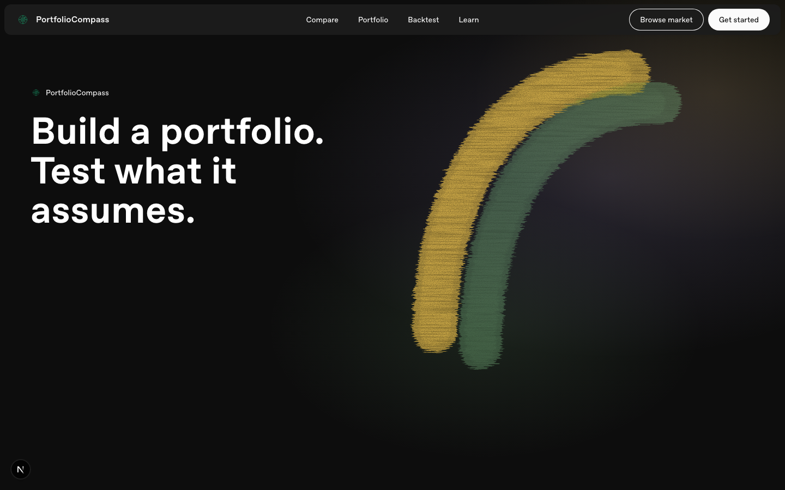
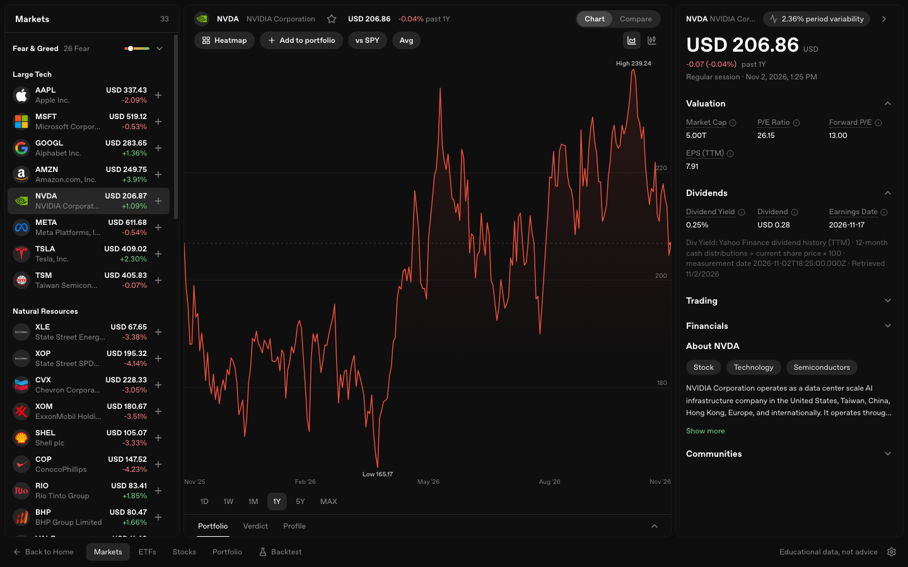
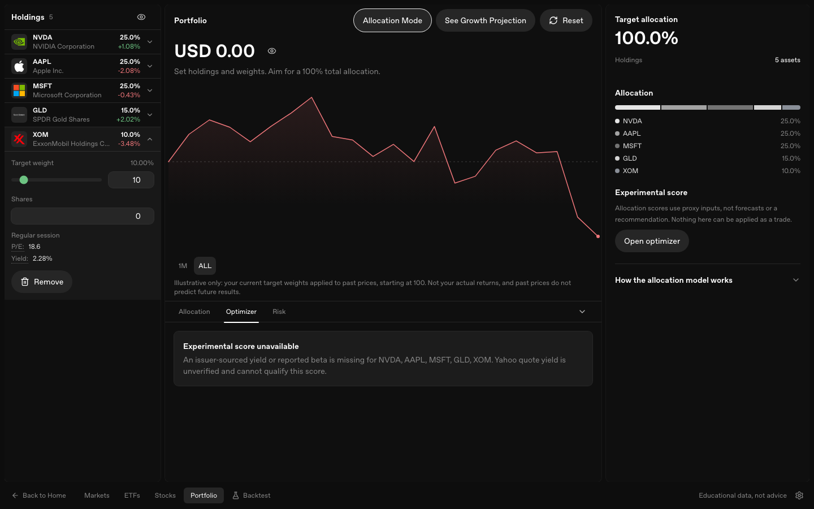
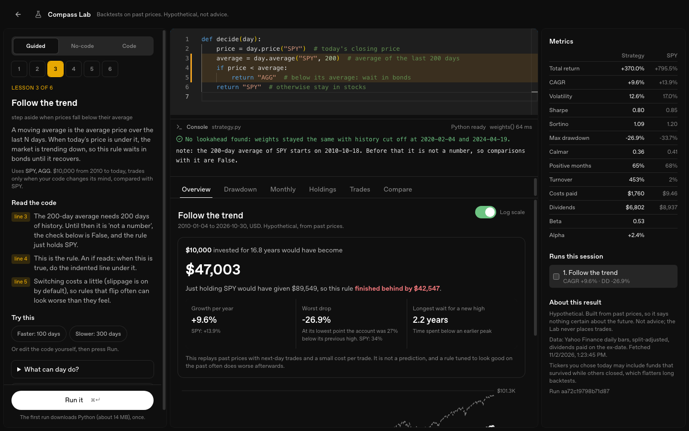

# Portfolio Compass

[](https://github.com/MenuuTUX/Portfolio-Compass/actions/workflows/ci.yml)

**Live demo: [portfolio-compass.vercel.app](https://portfolio-compass.vercel.app)**

A free planning tool for people who have just opened a TFSA. Check your contribution room, compare funds, build a portfolio, and test how it would have held up. It never places trades and gives no investment advice.

I built it for people my age who open a TFSA and then have to decide what to do with it. The aim is to make a long-term, diversified plan easier to work out than a guess on a hot tip. Every figure shows its assumptions, and every projection says what it is not.



| Market workspace | Portfolio builder |
|---|---|
|  |  |



## How a new TFSA investor can use it

1. **Plan.** The [TFSA planner](https://portfolio-compass.vercel.app/tfsa) works out your contribution room from the CRA's published yearly limits, warns if your monthly plan would go over it (the CRA taxes an excess at 1% a month), and shows what steady saving adds up to under assumed returns.
2. **Compare.** Search stocks and ETFs, including Canadian-listed funds priced in CAD, with quotes, charts, fees and yields side by side and no automatic winner labels.
3. **Build.** Hold a portfolio in the browser with no login. Totals and projections are withheld when a quote is stale or currencies differ and dated FX is unavailable.
4. **Test.** Run Monte Carlo paths on a portfolio's own price history, or replay a strategy over past prices in Compass Lab and see how the idea fared in the older and newer parts of history.

## Compass Lab

Lab is a backtesting workspace at `/lab` with a guided mode, a no-code mode and a code mode (Python through Pyodide, or TypeScript).

- Strategy code only returns target weights. A TypeScript engine in `lib/lab/engine/` handles fills, costs, dividends, rebalancing and metrics, so every mode produces comparable numbers.
- Orders fill at the next bar's open, never on the bar that produced the signal. A heuristic check also flags strategies whose weights change when future prices are removed.
- Metrics: CAGR, volatility, Sharpe, Sortino, Calmar, maximum drawdown, beta and alpha, turnover and costs.
- Each result also shows the first 70% and last 30% of the history side by side, so a rule that only worked early on is visible.
- Each run stores a hash of the code, parameters, data and engine version, so a run can be reproduced.
- Daily bars are cached in the browser (IndexedDB) and fetched through `/api/market/bars`.

Not built yet: walk-forward tests, parameter sweeps and a multiple-testing warning. See the limitations below.

### Example

[docs/example-backtest.md](docs/example-backtest.md) tests a 200-day trend filter on SPY from 2005 to 2026. The filter cut maximum drawdown from 55% to 26% over the full period. On a hold-out period starting in 2020 the benefit disappeared. The note covers what could be wrong with that result.

## Architecture

**No server database.** Nothing user-specific is stored on a server.

| Data | Where |
|------|--------|
| Portfolio holdings (tickers, weights, shares) | Browser LocalStorage |
| Lab strategies, runs and cached price bars | Browser IndexedDB |
| Quotes, charts, search, fund details | Live Yahoo and scraper data through API routes |
| Fear & Greed gauge | Live CNN index |
| TFSA limits | A table in `lib/tfsa.ts`, from the CRA |

Hosting runs the Next.js app and its API proxies. Clearing site data clears the portfolio, so export a JSON backup first. The `/api` routes are limited to 120 requests per minute per IP in `proxy.ts`.

Stack: Next.js (App Router), React, TypeScript, Bun, TanStack Query, Tailwind CSS, Recharts, Pyodide and Monaco (Lab only). CI runs typecheck, lint and 390+ unit tests on every pull request.

## Known limitations

- The main site shows price returns, not total returns. Dividends are not included. The Lab models dividends.
- The allocation score is a heuristic, not a Sharpe optimizer. It uses a provider-reported yield and a beta-based return proxy (beta times an assumed 6%), and it cannot apply trades.
- Monte Carlo uses historical price returns and geometric Brownian motion. The paths are illustrative, not forecasts. Each run uses a random seed that is shown and can be reused.
- The first-70% and last-30% view compares two pieces of one run. The rule is not refit between them, so it is a consistency check, not a true out-of-sample test.
- Lookahead in strategy code is detected heuristically, not prevented by construction.
- The TFSA planner knows the CRA's published limits through 2026 and only what you type in. Check your real room in CRA My Account.
- Market data comes from Yahoo Finance and scrapers and has not been cross-checked against a second source.
- Lab results depend on one data source and one cost model, and ignore taxes.

More detail is in [docs/interview-notes.md](docs/interview-notes.md), including the places where design docs and code disagree.

## Getting started

Requires [Bun](https://bun.sh/).

```bash
git clone https://github.com/MenuuTUX/Portfolio-Compass.git
cd Portfolio-Compass
bun install
bun run dev
```

Open [http://localhost:3000](http://localhost:3000). No environment variables are required.

| Command | Purpose |
|---------|---------|
| `bun run dev` | Dev server |
| `bun run build` | Production build |
| `bun test` | Unit tests |
| `bun run lint` | ESLint |
| `bun run typecheck` | `tsc --noEmit` |

## License

MIT. See [LICENSE](LICENSE).
